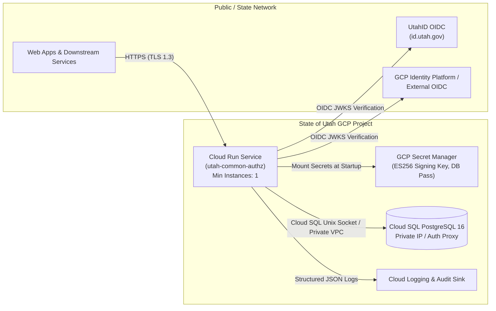

# GCP Deployment Guide — Utah Common Authentication & Authorization

This guide provides step-by-step instructions to deploy the **Utah Common Authentication & Authorization (Zero Trust IAM / PDP)** service to **Google Cloud Run** backed by **Cloud SQL for PostgreSQL** and **GCP Secret Manager**.

---

## Table of Contents
1. [Target GCP Architecture](#1-target-gcp-architecture)
2. [Step 1: Enable Required GCP APIs & Set Variables](#2-step-1-enable-required-gcp-apis--set-variables)
3. [Step 2: Provision Cloud SQL for PostgreSQL 16](#3-step-2-provision-cloud-sql-for-postgresql-16)
4. [Step 3: Apply Database Schema & Seed Migrations](#4-step-3-apply-database-schema--seed-migrations)
5. [Step 4: Generate Signing Keys & Store Secrets in Secret Manager](#5-step-4-generate-signing-keys--store-secrets-in-secret-manager)
6. [Step 5: Configure Least-Privilege IAM Service Account](#6-step-5-configure-least-privilege-iam-service-account)
7. [Step 6: Build & Deploy to GCP Cloud Run](#7-step-6-build--deploy-to-gcp-cloud-run)
8. [Step 7: Configure UtahID OIDC & External Identity Providers](#8-step-7-configure-utahid-oidc--external-identity-providers)
9. [Production Hardening & Operations Checklist](#9-production-hardening--operations-checklist)

---

## 1. Target GCP Architecture



---

## 2. Step 1: Enable Required GCP APIs & Set Variables

```bash
export PROJECT_ID="utah-dwre-prod"          # Replace with your GCP Project ID
export REGION="us-west3"                    # Salt Lake City (us-west3) region
export SQL_INSTANCE="utah-authz-pg16"
export DB_NAME="utah_authz"
export DB_USER="authz_app_user"
export SERVICE_NAME="utah-common-authz"
export REPO_NAME="utah-iam-containers"

gcloud config set project "${PROJECT_ID}"

gcloud services enable \
  run.googleapis.com \
  sqladmin.googleapis.com \
  secretmanager.googleapis.com \
  artifactregistry.googleapis.com \
  cloudbuild.googleapis.com \
  identitytoolkit.googleapis.com
```

---

## 3. Step 2: Provision Cloud SQL for PostgreSQL 16

Provision a regional High-Availability PostgreSQL 16 instance in `us-west3` (Salt Lake City):

```bash
# 1. Create the Cloud SQL PostgreSQL 16 instance
gcloud sql instances create "${SQL_INSTANCE}" \
  --database-version=POSTGRES_16 \
  --region="${REGION}" \
  --tier=db-custom-2-8192 \
  --availability-type=REGIONAL \
  --storage-type=SSD \
  --storage-size=50GB \
  --storage-auto-increase \
  --backup-start-time=08:00 \
  --deletion-protection

# 2. Create the database
gcloud sql databases create "${DB_NAME}" --instance="${SQL_INSTANCE}"

# 3. Generate a strong database password and create the application DB user
export DB_PASS="$(openssl rand -base64 32)"
gcloud sql users create "${DB_USER}" \
  --instance="${SQL_INSTANCE}" \
  --password="${DB_PASS}"
```

---

## 4. Step 3: Apply Database Schema & Seed Migrations

Connect via the **Cloud SQL Auth Proxy** to apply the initial schema (`pgcrypto`, `ltree`, tables, indexes) and State of Utah seed data:

```bash
# 1. Start Cloud SQL Auth Proxy in the background on port 5433
cloud-sql-proxy "${PROJECT_ID}:${REGION}:${SQL_INSTANCE}" --port 5433 &
PROXY_PID=$!

# 2. Apply schema and seed migrations
PGPASSWORD="${DB_PASS}" psql \
  -h 127.0.0.1 -p 5433 -U "${DB_USER}" -d "${DB_NAME}" \
  -f migrations/000001_init_schema.up.sql

PGPASSWORD="${DB_PASS}" psql \
  -h 127.0.0.1 -p 5433 -U "${DB_USER}" -d "${DB_NAME}" \
  -f migrations/000002_seed_utah_defaults.up.sql

kill "${PROXY_PID}"
```

---

## 5. Step 4: Generate Signing Keys & Store Secrets in Secret Manager

The service uses an **ECDSA P-256 (`ES256`)** private key to sign exchanged application JWTs and publishes the corresponding public key at `/.well-known/jwks.json`.

```bash
# 1. Generate a production ECDSA P-256 private key PEM
openssl ecparam -name prime256v1 -genkey -noout -out /tmp/authz-signing-key.pem

# 2. Store the signing key in GCP Secret Manager
gcloud secrets create authz-signing-private-key \
  --replication-policy="user-managed" \
  --locations="${REGION}"
gcloud secrets versions add authz-signing-private-key \
  --data-file=/tmp/authz-signing-key.pem
rm -f /tmp/authz-signing-key.pem

# 3. Store the Cloud SQL database password in Secret Manager
printf "%s" "${DB_PASS}" | gcloud secrets create authz-db-password \
  --replication-policy="user-managed" \
  --locations="${REGION}" \
  --data-file=-

# 4. Store an initial bootstrap key (used once to assign your first UtahID Super Admin, then disabled)
export BOOTSTRAP_KEY="$(openssl rand -hex 32)"
printf "%s" "${BOOTSTRAP_KEY}" | gcloud secrets create authz-admin-bootstrap-key \
  --replication-policy="user-managed" \
  --locations="${REGION}" \
  --data-file=-
```

---

## 6. Step 5: Configure Least-Privilege IAM Service Account

Create a dedicated service account for the Cloud Run service:

```bash
export SA_NAME="utah-authz-runner"
export SA_EMAIL="${SA_NAME}@${PROJECT_ID}.iam.gserviceaccount.com"

gcloud iam service-accounts create "${SA_NAME}" \
  --display-name="Utah Common AuthN/AuthZ Cloud Run Service Account"

# Grant Cloud SQL Client access
gcloud projects add-iam-policy-binding "${PROJECT_ID}" \
  --member="serviceAccount:${SA_EMAIL}" \
  --role="roles/cloudsql.client"

# Grant Secret Manager Accessor on the three secrets
for SECRET in authz-signing-private-key authz-db-password authz-admin-bootstrap-key; do
  gcloud secrets add-iam-policy-binding "${SECRET}" \
    --member="serviceAccount:${SA_EMAIL}" \
    --role="roles/secretmanager.secretAccessor"
done
```

---

## 7. Step 6: Build & Deploy to GCP Cloud Run

```bash
# 1. Create Artifact Registry repository (once)
gcloud artifacts repositories create "${REPO_NAME}" \
  --repository-format=docker \
  --location="${REGION}" \
  --description="Utah IAM & AuthZ container images"

# 2. Build and push the distroless Go container image via Cloud Build
export IMAGE_URI="${REGION}-docker.pkg.dev/${PROJECT_ID}/${REPO_NAME}/${SERVICE_NAME}:v1.0.0"
gcloud builds submit --tag "${IMAGE_URI}" .

# 3. Deploy to Cloud Run in us-west3 (Salt Lake City)
gcloud run deploy "${SERVICE_NAME}" \
  --image="${IMAGE_URI}" \
  --region="${REGION}" \
  --service-account="${SA_EMAIL}" \
  --add-cloudsql-instances="${PROJECT_ID}:${REGION}:${SQL_INSTANCE}" \
  --set-env-vars="ENVIRONMENT=production" \
  --set-env-vars="INSTANCE_UNIX_SOCKET=/cloudsql/${PROJECT_ID}:${REGION}:${SQL_INSTANCE}" \
  --set-env-vars="DB_USER=${DB_USER}" \
  --set-env-vars="DB_NAME=${DB_NAME}" \
  --set-env-vars="AUTHZ_ISSUER_URL=https://authz.water.utah.gov" \
  --set-env-vars="AUTHZ_SIGNING_KEY_ID=utah-zero-trust-key-2026-01" \
  --set-secrets="DB_PASS=authz-db-password:latest" \
  --set-secrets="AUTHZ_SIGNING_PRIVATE_KEY_PEM=authz-signing-private-key:latest" \
  --set-secrets="ADMIN_BOOTSTRAP_API_KEY=authz-admin-bootstrap-key:latest" \
  --min-instances=1 \
  --max-instances=20 \
  --cpu=1 \
  --memory=512Mi \
  --allow-unauthenticated
```

> **Note on `--allow-unauthenticated`**: Because browser SPAs call `POST /v1/auth/token` and `GET /.well-known/jwks.json` directly, the Cloud Run HTTPS ingress is public, while every endpoint enforces cryptographic OIDC / JWT verification and Zero Trust policy checks inside the Go service.

---

## 8. Step 7: Configure UtahID OIDC & External Identity Providers

### 1. Registering Your Production UtahID Client
Update or register your UtahID production `client_id` and `issuer_url` via `POST /v1/admin/idps`:

```bash
export SERVICE_URL="$(gcloud run services describe ${SERVICE_NAME} --region=${REGION} --format='value(status.url)')"

curl -X POST "${SERVICE_URL}/v1/admin/idps" \
  -H "X-Admin-Bootstrap-Key: ${BOOTSTRAP_KEY}" \
  -H "Content-Type: application/json" \
  -d '{
    "slug": "utahid-prod",
    "name": "State of Utah (UtahID OIDC)",
    "provider_type": "utahid",
    "issuer_url": "https://id.utah.gov/oauth2/default",
    "client_id": "YOUR_UTAHID_OIDC_CLIENT_ID",
    "claim_mappings": {
      "sub": "sub",
      "email": "email",
      "name": "name",
      "groups": "groups",
      "mfa": "amr"
    },
    "is_internal_state": true,
    "auto_provision": true,
    "is_active": true
  }'
```

### 2. Bootstrapping Your First UtahID IAM Super Admin
1. Log in once with your State of Utah employee account via `POST /v1/auth/token` targeting `water-resources-map` (which provisions your canonical `users` record and returns your `user.id`).
2. Grant your user ID the `iam_super_admin` role in `utah-iam-admin`:
   ```bash
   curl -X POST "${SERVICE_URL}/v1/admin/apps/utah-iam-admin/assignments" \
     -H "X-Admin-Bootstrap-Key: ${BOOTSTRAP_KEY}" \
     -H "Content-Type: application/json" \
     -d '{
       "role_slug": "iam_super_admin",
       "principal_type": "user",
       "user_id": "<YOUR_PROVISIONED_USER_UUID>",
       "effect": "allow",
       "justification": "Initial production IAM Super Administrator"
     }'
   ```
3. **Disable the Bootstrap Key**: Remove `ADMIN_BOOTSTRAP_API_KEY` from the Cloud Run service so all future `/v1/admin/*` operations require a live, MFA-verified UtahID token exchanged for `utah-iam-admin`:
   ```bash
   gcloud run services update "${SERVICE_NAME}" \
     --region="${REGION}" \
     --remove-secrets="ADMIN_BOOTSTRAP_API_KEY"
   ```

---

## 9. Production Hardening & Operations Checklist

- [ ] **Bootstrap Key Removed**: Confirm `ADMIN_BOOTSTRAP_API_KEY` is unset after assigning at least two `iam_super_admin` users.
- [ ] **Cloud Armor / Custom Domain**: Place a Global External Application Load Balancer with **Google Cloud Armor** in front of the Cloud Run service (`authz.water.utah.gov`) with rate-limiting rules on `/v1/auth/token`.
- [ ] **Private VPC Egress to Cloud SQL**: For strict network isolation, attach a Direct VPC Egress or Serverless VPC Access connector and configure Cloud SQL with Private IP only.
- [ ] **Audit Log Retention**: Configure a Cloud Logging sink or scheduled `pg_partman` archive job for `audit_logs`.
- [ ] **Signing Key Rotation**: Generate a new ECDSA P-256 key in Secret Manager, update `AUTHZ_SIGNING_KEY_ID`, and deploy a new Cloud Run revision. Because exchanged tokens have a short 10–15 minute TTL, key rotation completes within 15 minutes.
