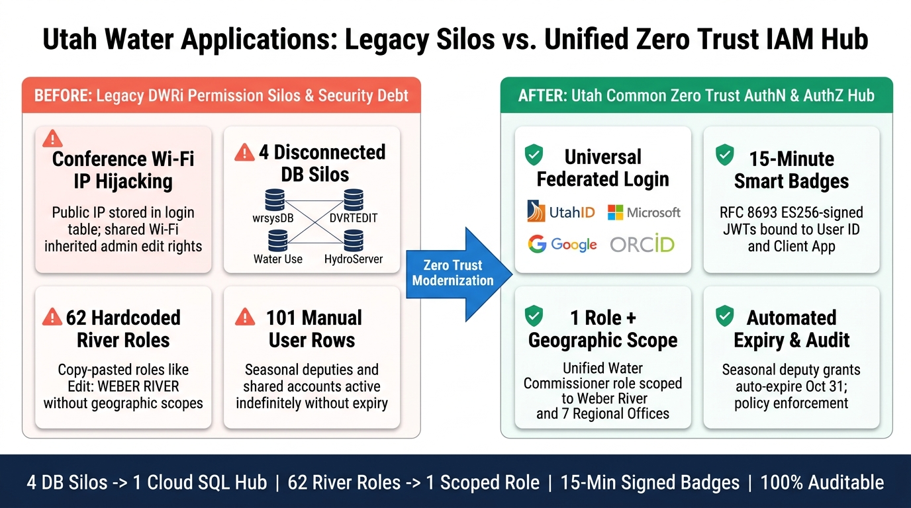
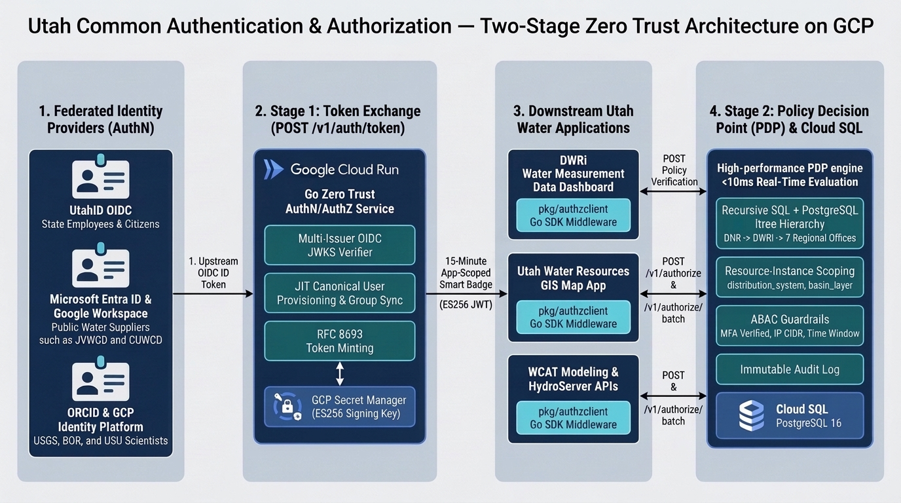
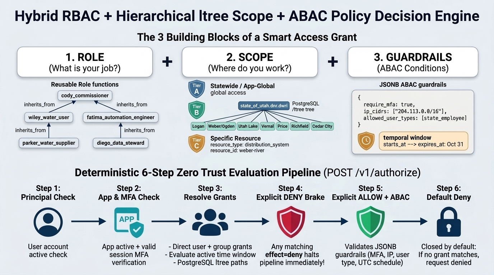
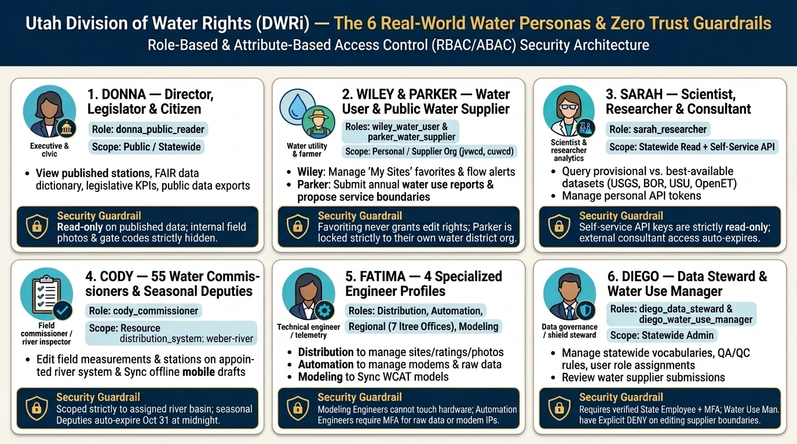

# Visual Architecture & Solution Guide — Utah Common Authentication & Authorization

This document contains the visual architecture and infographic diagrams for the **Utah Common Authentication & Authorization (Zero Trust IAM / PDP)** service.

---

## 1. Executive Transformation: Legacy Silos vs. Unified Zero Trust Hub

### Key Architectural Takeaways
* **Eliminating Public Wi-Fi IP Hijacking**: Legacy `login.waterrights.utah.gov` recorded a user's external IP address in a database table to track login state—meaning anyone on shared conference or hotel Wi-Fi inherited that employee's session. The new service replaces this with **RFC 8693 Token Exchange** (`internal/authn/token_exchange.go`), issuing 15-minute ES256-signed JWTs bound to the individual user (`sub`) and target application (`aud`).
* **Consolidating 4 Silos into 1 Hub**: Unifies `wrsysDB` (40 apps), `DVRTEDIT`, `Water Use Program`, and `HydroServer` behind a single Cloud SQL for PostgreSQL 16 schema (`migrations/000001_init_schema.up.sql`).
* **62 Hardcoded River Roles -> 1 Scoped Role**: Replaces 62 copy-pasted role strings (`"Edit: WEBER RIVER"`, `"LOWER BEAR - IDAHO"`) with a single reusable `cody_commissioner` role dynamically scoped to `resource_type = "distribution_system"` and `resource_id = "weber-river"`.

---

## 2. End-to-End GCP Cloud Architecture & Two-Stage Zero Trust Flow

### How the Two-Stage Flow Works
1. **Stage 1 — Multi-Issuer OIDC Federation & Token Exchange (`POST /v1/auth/token`)**:
   * `MultiIssuerVerifier` (`internal/authn/oidc_manager.go`) validates upstream OIDC tokens from **UtahID**, **Microsoft Entra ID**, **Google Workspace**, or **ORCID** against cached JWKS endpoints.
   * `TokenExchangeService.Exchange` (`internal/authn/token_exchange.go`) performs Just-In-Time (JIT) user provisioning, synchronizes external IdP group claims, verifies that the target application trusts the upstream IdP, and mints a short-lived ES256 JWT.
2. **Stage 2 — Real-Time Policy Decision Point (`POST /v1/authorize` & `POST /v1/authorize/batch`)**:
   * Downstream applications use the reusable Go SDK middleware (`pkg/authzclient/client.go`) or REST calls to verify fine-grained resource actions in under 10 milliseconds.

---

## 3. Hybrid RBAC + Hierarchical `ltree` Scope + ABAC Decision Engine

### The 3 Building Blocks Formula
`Smart Access Grant = 1. Role (Job) + 2. Scope (Global / Org ltree / Resource ID) + 3. Guardrails (ABAC JSONB)`

* **Deterministic 6-Step Precedence** (`internal/authz/pdp.go`):
  1. **Principal Check**: User exists and `status = 'active'`.
  2. **App & MFA Check**: Target application is active and app-wide MFA requirements are satisfied.
  3. **Candidate Grant Resolution**: Single-pass recursive SQL query resolves direct user grants, group memberships, active temporal windows (`starts_at` / `expires_at`), PostgreSQL `ltree` ancestor paths (`state_of_utah.dnr.dwri.region_*`), and specific `resource_id` matches.
  4. **Explicit `DENY` Brake**: Any matching `effect = 'deny'` rule immediately blocks the request (`reason: "explicit_deny_rule"`).
  5. **Explicit `ALLOW` + ABAC Evaluator** (`internal/authz/abac.go`): Verifies `require_mfa`, `ip_cidrs`, `allowed_user_types`, `required_attributes`, and `allowed_hours_utc`.
  6. **Default Deny**: Closed by default when no explicit grant matches.

---

## 4. The 6 Utah Water Personas & Zero Trust Guardrails

All 6 personas and their 11 sub-persona roles are seeded automatically in `migrations/000003_seed_dwri_personas_and_apps.up.sql` and verified by end-to-end integration tests in `internal/api/dwri_personas_test.go`.
